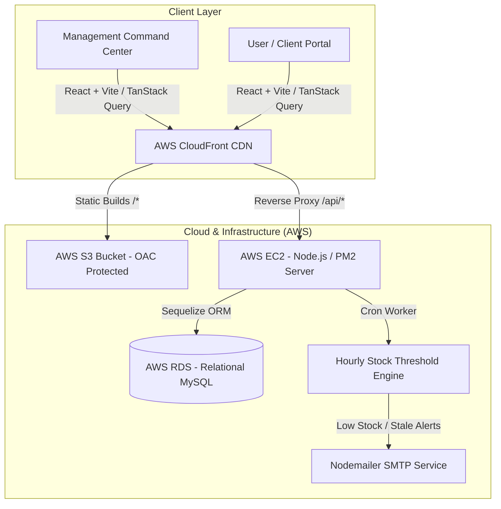

# Enterprise Inventory & Command Center

[](https://nodejs.org/)
[](https://reactjs.org/)
[](https://sequelize.org/)
[](https://aws.amazon.com/)
[](LICENSE)

Its is a full-stack, cloud-native inventory management and monitoring platform designed to streamline stock tracking, client order fulfillment, and automated stockout prevention.

By bridging a dual-portal interface, automated background consumption auditing, financial balance tracking, and enterprise cloud routing, UNISIP eliminates operational friction and provides total visibility into supply chain metrics.

---

## 🚀 Key Features

- **🏢 Dual-Portal Architecture** — Separate, role-tailored interfaces for Management (Command Center) and Users/Clients (Client Portal).
- **⏰ Automated Background Worker** — Hourly `node-cron` background tasks that dynamically calculate 30-day average daily consumption rates to evaluate stock safety thresholds.
- **📧 Intelligent Email Alerts** — Automated **Nodemailer** dispatches for critical low-stock warnings (< 20% monthly threshold) and stale stock reminders (> 3 days untouched).
- **📊 Financial & Balance Monitoring** — Real-time tracking of client orders, pending balances, payment statuses, and historical transaction logs.
- **⚡ Optimized Data Fetching** — Integrated **TanStack Query** (React Query) to enforce 5-minute stale-time caching and state synchronization, drastically reducing backend server load.
- **🌐 Enterprise Cloud Infrastructure** — Frontend static bundle served via AWS S3 with Origin Access Control (OAC), paired with secure reverse proxying via AWS CloudFront to a Node.js/PM2 backend on AWS EC2 and AWS RDS (MySQL).

---

## 🏗️ System Architecture



> **Note:** This diagram renders as a live flowchart natively on GitHub.com — it may show as plain text in other previews (editors, chat tools, some IDEs).

---

## 🛠️ Tech Stack

| Domain | Technologies |
|---|---|
| **Frontend** | React (Vite), Tailwind CSS, TanStack Query (React Query), Axios |
| **Backend** | Node.js, Express.js, Sequelize ORM, Node-Cron, Nodemailer |
| **Database** | MySQL (AWS RDS) |
| **Authentication** | JSON Web Tokens (JWT), BcryptJS, Cookie-Parser |
| **Cloud & DevOps** | AWS S3, AWS CloudFront, AWS EC2, PM2 Process Manager, CORS Security |

---

## 📁 Repository Structure

```
unisip-inventory/
├── client/                   # Frontend React + Vite application
│   ├── src/
│   │   ├── components/       # Reusable UI components, Modals, Tables, Layouts
│   │   ├── context/          # AuthProvider and ToastProvider global contexts
│   │   ├── pages/            # AdminDashboard, ClientDashboard, StockManagement, OrderManagement
│   │   └── services/         # Axios instance & API request interceptors
│   └── package.json
└── server/                   # Backend Node.js + Express application
    ├── config/               # Database and Sequelize configuration
    ├── controllers/          # Business logic handlers (Auth, Stock, Orders, Clients)
    ├── jobs/                 # Node-cron background worker logic
    ├── models/               # Sequelize MySQL schemas & associations
    ├── routes/               # Modular REST API route declarations (/api/*)
    └── package.json
```

---

## 🚦 Getting Started

### Prerequisites

- **Node.js**: v18.x or higher
- **npm**: v9.x or higher
- **MySQL**: Local instance or AWS RDS instance

### 1. Clone the Repository

```bash
git clone https://github.com/your-username/unisip-inventory.git
cd unisip-inventory
```

### 2. Backend Setup

```bash
cd server
npm install
```

Create a `.env` file in the `server/` directory:

```env
PORT=5000
NODE_ENV=development
DB_HOST=localhost
DB_USER=root
DB_PASSWORD=your_password
DB_NAME=unisip_db
JWT_SECRET=your_super_secret_jwt_key
SMTP_HOST=smtp.gmail.com
SMTP_PORT=587
SMTP_USER=your_email@gmail.com
SMTP_PASS=your_email_app_password
```

Start the backend server:

```bash
npm run dev
```

### 3. Frontend Setup

```bash
cd ../client
npm install
```

Create a `.env` file in the `client/` directory:

```env
VITE_API_BASE_URL=http://localhost:5000/api
```

Start the frontend Vite application:

```bash
npm run dev
```


---

## 🔒 Security & Cloud Highlights

- **HTTP-Only Cookies & Bearer Tokens** — Versatile JWT authentication supporting both strict HTTP-only cookies and `Authorization: Bearer` headers.
- **Origin Access Control (OAC)** — S3 buckets locked from direct public internet access, permitting traffic strictly via authenticated CloudFront distributions.
- **Unified Reverse Proxy Architecture** — AWS CloudFront handles HTTPS termination and routes `/api/*` traffic directly to EC2, bypassing CORS issues and eliminating mixed-content errors.
- **Role-Based Access Control (RBAC)** — Backend middleware enforcing granular access barriers between Admin management routes and Client portal routes.

---

## 📄 License

Distributed under the MIT License. See [LICENSE](LICENSE) for more information.
